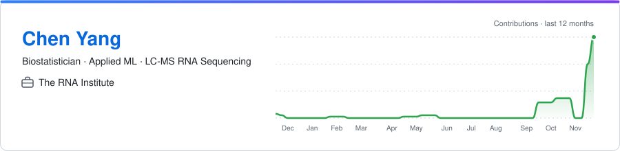
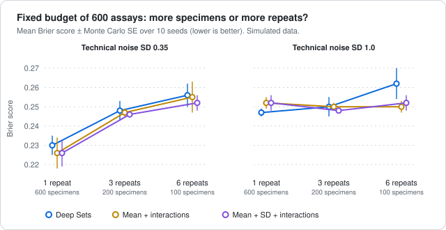
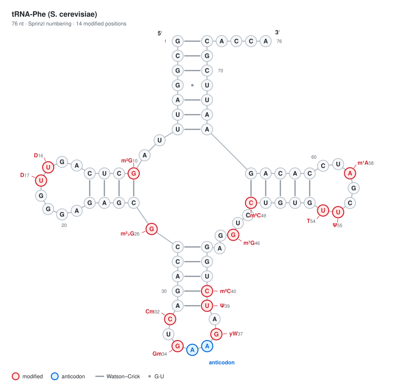
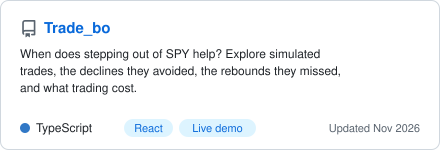
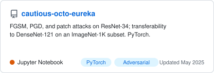

<h1 align="center">Chen Yang</h1>

<b>Biostatistics · Applied ML · LC-MS RNA Sequencing · Python / R</b>

Biostatistician building analysis infrastructure for LC-MS-based RNA modification sequencing: mass-ladder matching, replicate-level uncertainty quantification, and reproducible publication figures.

<picture>
  <source media="(prefers-color-scheme: dark)" srcset="https://raw.githubusercontent.com/Chencharl/Chencharl/output/wave-dark.svg" />
  
</picture>

## Selected work

### ReplicateShift · does measuring more specimens beat more technical repeats?

<table width="100%" cellspacing="0" cellpadding="8" border="0">
<tr>
<td width="44%" valign="top">

**Question.** With a fixed budget of 600 assays, is it better to measure 600 specimens once, 200 three times, or 100 six times?

**Result.** In the simulated pilot, spreading the budget over more specimens gave the lowest error: Brier 0.226–0.230 at one repeat versus 0.252–0.256 at six (noise SD 0.35). A Deep Sets encoder beat the logistic baselines only under high noise with single measurements, by about 0.005 Brier.

**What it is not.** Ten seeds, synthetic data, exploratory. No real-data benefit is claimed.

[Results report](https://github.com/Chencharl/replicateshift/blob/main/results/allocation_v0.2/REPORT.md) · [Repository](https://github.com/Chencharl/replicateshift)

</td>
<td width="56%" valign="top">

<picture>
  <source media="(prefers-color-scheme: dark)" srcset="https://raw.githubusercontent.com/Chencharl/Chencharl/main/assets/replicateshift-allocation-dark.svg" />
  
</picture>

</td>
</tr>
</table>

### RNA Layout Tool · publication-ready RNA structure figures

<table width="100%" cellspacing="0" cellpadding="8" border="0">
<tr>
<td width="58%" valign="top">

<picture>
  <source media="(prefers-color-scheme: dark)" srcset="https://raw.githubusercontent.com/Chencharl/Chencharl/main/assets/trna-phe-bubble-dark.svg" />
  
</picture>

</td>
<td width="42%" valign="top">

**What it does.** Draws tRNA cloverleaf and rRNA secondary-structure figures from an explicit sequence, a fixed structure template, and an annotation table. It plots structure; it does not predict it.

**The hard part.** Sprinzl numbering is not derivable from sequence alone. Positions such as 17, 17A, 20A and 20B need a human decision, so the editor separates the label shown on the figure from the template slot that sets its coordinates. Modifications, isoforms, truncations and terminal chemistry live on separate annotation layers.

**Output.** Editable SVG, PNG, and figure JSON.

Figure: yeast tRNA-Phe, a public reference sequence, drawn one bubble per base with its 14 known modifications.

[Try it live](https://rna-layout-tool.vercel.app/) · [Repository](https://github.com/Chencharl/rna-layout-tool)

</td>
</tr>
</table>

## LC-MS RNA sequencing

My main work is turning LC-MS data from RNA hydrolysis ladders into modification maps that hold up in review.

| Stage | Detail |
| --- | --- |
| **Input** | Deconvoluted mass lists from 5′ and 3′ ladders and intact-mass runs, across technical and biological replicates |
| **Judgment I am responsible for** | Mass-matching tolerance (10 ppm), which ladder direction and terminus model supports a call, when a gap is a modification rather than a missing fragment, and treating a missing position as missing instead of zero |
| **Output** | Sprinzl-numbered modification maps, site-level stoichiometry of partially modified positions, per-run QC flags, and figures built to journal specifications |
| **Ambiguity that remains** | Mass-silent and isobaric modifications (Ψ vs U, positional methyl isomers) cannot be resolved by mass alone; ambiguous Sprinzl positions still need manual confirmation |

Pipelines and data from ongoing studies stay private until publication. The public tools above use synthetic data or public reference sequences.

## More projects

<table width="100%" cellspacing="0" cellpadding="4" border="0">
<tr>
<td width="50%" valign="top"><a href="https://github.com/Chencharl/psychic-rotary-phone"><picture>
  <source media="(prefers-color-scheme: dark)" srcset="https://raw.githubusercontent.com/Chencharl/Chencharl/output/repo-psychic-rotary-phone-dark.svg" />
  
</picture></a></td>
<td width="50%" valign="top"><a href="https://github.com/Chencharl/Trade_bo"><picture>
  <source media="(prefers-color-scheme: dark)" srcset="https://raw.githubusercontent.com/Chencharl/Chencharl/output/repo-Trade_bo-dark.svg" />
  
</picture></a></td>
</tr>
<tr>
<td width="50%" valign="top"><a href="https://github.com/Chencharl/Research_hunter"><picture>
  <source media="(prefers-color-scheme: dark)" srcset="https://raw.githubusercontent.com/Chencharl/Chencharl/output/repo-Research_hunter-dark.svg" />
  
</picture></a></td>
<td width="50%" valign="top"><a href="https://github.com/Chencharl/cautious-octo-eureka"><picture>
  <source media="(prefers-color-scheme: dark)" srcset="https://raw.githubusercontent.com/Chencharl/Chencharl/output/repo-cautious-octo-eureka-dark.svg" />
  
</picture></a></td>
</tr>
</table>

Also: <a href="https://github.com/Chencharl/vigilant-funicular">vigilant-funicular</a> LoRA on RoBERTa, 94.6% AG News · <a href="https://github.com/Chencharl/congenial-octo-garbanzo">congenial-octo-garbanzo</a> CIFAR-10 ResNet under 5M params · <a href="https://github.com/Chencharl/friendly-waffle">friendly-waffle</a> stroke risk in R · <a href="https://github.com/Chencharl/NYC-Rental-Trends-and-Housing-Litigations">NYC-Rental-Trends-and-Housing-Litigations</a> NYC housing, open data

<b>Stack</b> &nbsp; Python · R · TypeScript · SQL · PyTorch · scikit-learn · pandas · tidyverse · pytest · GitHub Actions · React · LaTeX

<picture>
  <source media="(prefers-color-scheme: dark)" srcset="https://raw.githubusercontent.com/Chencharl/Chencharl/output/github-snake-dark.svg" />
  
</picture>
