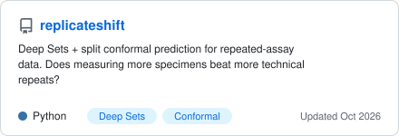
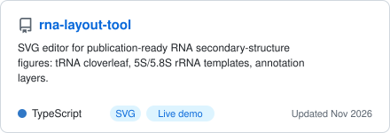
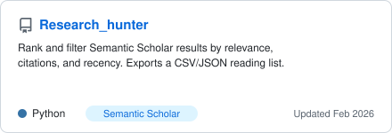
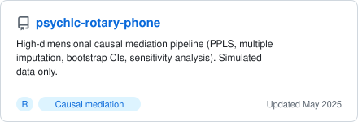

<h1 align="center">Chen Yang</h1>

<b>Biostatistics · Applied ML · LC-MS RNA Sequencing · Python / R</b>

Biostatistician building analysis infrastructure for LC-MS-based RNA modification sequencing: mass-ladder matching, replicate-level uncertainty quantification, and reproducible publication figures.

<picture>
  <source media="(prefers-color-scheme: dark)" srcset="https://raw.githubusercontent.com/Chencharl/Chencharl/output/wave-dark.svg" />
  
</picture>

## 🔬 Focus

<table width="100%" cellspacing="0" cellpadding="10">
<tr>
<td width="50%" valign="top">

🧬 **LC-MS RNA sequencing analysis** 
Pipelines from deconvoluted LC-MS workbooks to tRNA / rRNA modification maps: 5′ and 3′ ladder matching at 10 ppm, intact-mass census of tRNA families, site-level modification stoichiometry, Sprinzl-numbered output.

</td>
<td width="50%" valign="top">

🗄️ **Data management and QC** 
Schema-fixed CSV / Excel toolkits with reproducible configs, replicate-aware QC flags, pytest + GitHub Actions CI, and provenance from raw instrument export to final figure.

</td>
</tr>
<tr>
<td width="50%" valign="top">

📐 **Statistics for repeated measurements** 
Specimen-level uncertainty with Deep Sets + split conformal prediction; fixed-budget experiments on whether to measure more specimens or more technical repeats.

</td>
<td width="50%" valign="top">

🩺 **Biostatistics and causal inference** 
High-dimensional causal mediation (PPLS), multiple imputation for mixed-type missingness, bootstrap confidence intervals, sensitivity analysis for unmeasured confounding.

</td>
</tr>
<tr>
<td width="50%" valign="top">

🖼️ **Publication figure tooling** 
SVG editors and scripts for tRNA cloverleaf and rRNA secondary-structure figures with modification annotation layers, built to Nature / Cell figure specifications.

</td>
<td width="50%" valign="top">

📈 **Quantitative research tooling** 
Browser-based portfolio simulation and walk-forward strategy evaluation scored on false alarms, missed declines and foregone gains; ranked literature search over Semantic Scholar.

</td>
</tr>
</table>

## 🧩 Featured projects

<table width="100%" cellspacing="0" cellpadding="4" border="0">
<tr>
<td width="50%" valign="top"><a href="https://github.com/Chencharl/replicateshift"><picture>
  <source media="(prefers-color-scheme: dark)" srcset="https://raw.githubusercontent.com/Chencharl/Chencharl/output/repo-replicateshift-dark.svg" />
  
</picture></a></td>
<td width="50%" valign="top"><a href="https://github.com/Chencharl/rna-layout-tool"><picture>
  <source media="(prefers-color-scheme: dark)" srcset="https://raw.githubusercontent.com/Chencharl/Chencharl/output/repo-rna-layout-tool-dark.svg" />
  
</picture></a></td>
</tr>
<tr>
<td width="50%" valign="top"><a href="https://github.com/Chencharl/Trade_bo"><picture>
  <source media="(prefers-color-scheme: dark)" srcset="https://raw.githubusercontent.com/Chencharl/Chencharl/output/repo-Trade_bo-dark.svg" />
  
</picture></a></td>
<td width="50%" valign="top"><a href="https://github.com/Chencharl/Research_hunter"><picture>
  <source media="(prefers-color-scheme: dark)" srcset="https://raw.githubusercontent.com/Chencharl/Chencharl/output/repo-Research_hunter-dark.svg" />
  
</picture></a></td>
</tr>
<tr>
<td width="50%" valign="top"><a href="https://github.com/Chencharl/psychic-rotary-phone"><picture>
  <source media="(prefers-color-scheme: dark)" srcset="https://raw.githubusercontent.com/Chencharl/Chencharl/output/repo-psychic-rotary-phone-dark.svg" />
  
</picture></a></td>
<td width="50%" valign="top"><a href="https://github.com/Chencharl/cautious-octo-eureka"><picture>
  <source media="(prefers-color-scheme: dark)" srcset="https://raw.githubusercontent.com/Chencharl/Chencharl/output/repo-cautious-octo-eureka-dark.svg" />
  
</picture></a></td>
</tr>
</table>

Also: <a href="https://github.com/Chencharl/vigilant-funicular">vigilant-funicular</a> LoRA on RoBERTa, 94.6% AG News · <a href="https://github.com/Chencharl/congenial-octo-garbanzo">congenial-octo-garbanzo</a> CIFAR-10 ResNet under 5M params · <a href="https://github.com/Chencharl/friendly-waffle">friendly-waffle</a> stroke risk in R · <a href="https://github.com/Chencharl/NYC-Rental-Trends-and-Housing-Litigations">NYC-Rental-Trends-and-Housing-Litigations</a> NYC housing, open data

## 🛠 Skills

| Area | Tools |
| --- | --- |
| **Languages** |       |
| **ML and statistics** |           |
| **Data engineering and QC** |        |
| **Mass-spec RNA** |      |
| **Visualization and web** |        |

<picture>
  <source media="(prefers-color-scheme: dark)" srcset="https://raw.githubusercontent.com/Chencharl/Chencharl/output/github-snake-dark.svg" />
  
</picture>

## 🧰 Stack

